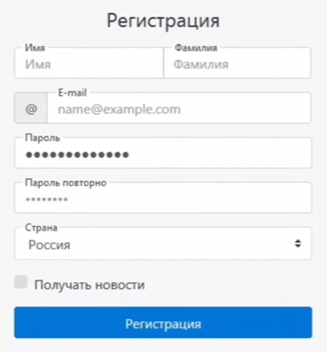

# REST API Design — Регистрация пользователя

### Учебный проект по системному анализу и проектированию REST API

## О проекте

Проект посвящён проектированию REST API для регистрации пользователя на основе интерфейса веб-приложения.

Цель проекта — определить необходимые API-методы, структуры запросов и ответов, правила валидации данных и обработку возможных ошибок.

В рамках проекта подготовлена техническая документация для взаимодействия клиентского приложения с сервером.

## Исходный интерфейс

Форма регистрации содержит следующие поля:
- Имя и фамилия
- Электронная почта
- Пароль и подтверждение пароля
- Страна
- Согласие на получение новостей

## Спроектированные API

| Метод | Endpoint | Назначение |
|---|---|---|
| POST | `/api/v1/register` | Регистрация нового пользователя |
| GET | `/api/v1/countries` | Получение справочника стран |

### POST /api/v1/register

Метод предназначен для регистрации пользователя.

В спецификации описаны:
- Структура JSON-запроса
- Типы данных и обязательность параметров
- Правила валидации
- Успешный ответ `201 Created`
- Обработка ошибок `400`, `409`, `500`
- Логика обработки запроса
- Основные требования безопасности

**[Документация POST /register](REST_API_HTTPS_POST.md)**

### GET /api/v1/countries

Метод предназначен для получения списка стран, доступных при регистрации.

В спецификации описаны:
- Структура JSON-ответа
- Формат кодов стран
- Успешный ответ `200 OK`
- Возможные ошибки
- Логика получения и использования справочника

**[Документация GET /countries](Countries.md)**

## Сценарий взаимодействия

1. Пользователь открывает форму регистрации.
2. Клиент запрашивает список стран через `GET /api/v1/countries`.
3. Сервер возвращает список стран.
4. Пользователь заполняет регистрационную форму.
5. Клиент отправляет данные через `POST /api/v1/register`.
6. Сервер выполняет проверку данных.
7. При успешной регистрации возвращается `201 Created` и идентификатор пользователя.
8. При ошибке возвращается соответствующий HTTP-статус и сообщение.

## Выполненные задачи

В ходе работы над проектом:

- Проанализировал пользовательский интерфейс.
- Определил необходимые API-методы.
- Спроектировал структуры Request Body и Response Body.
- Описал типы данных и обязательность полей.
- Сформулировал правила валидации.
- Определил HTTP-статусы и сценарии обработки ошибок.
- Описал последовательность взаимодействия клиента и сервера.
- Подготовил техническую документацию в Markdown.

## Использованные технологии и подходы

`REST API` · `HTTP/HTTPS` · `JSON` · `API Design` · `Client-Server Architecture` · `Markdown` · `GitHub`

## Результат

Подготовлены спецификации двух взаимосвязанных REST API-методов для сценария регистрации пользователя.

Проект демонстрирует навыки анализа интерфейсов, проектирования API-контрактов, описания бизнес-логики и документирования требований.

**Статус:** учебный проект. Реализация серверной части и тестирование работающего API не входят в текущий объём работы.
